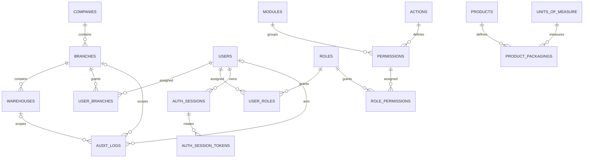

# Database foundation

## Structure

```text
src/
  config/
    configuration.ts
    validation.ts
  database/
    database.module.ts
    database.config.ts
    database.repository.ts
    data-source.ts
    entities/index.ts
    migrations/
    seeds/
  modules/
    company/
      company.module.ts
      company.entity.ts
      company.repository.ts
    branches/
      branch.entity.ts
      branch.repository.ts
    warehouses/
      warehouses.module.ts
      warehouse.entity.ts
      warehouse.repository.ts
      warehouse-operational-status.enum.ts
    users/
      users.module.ts
      user.entity.ts
      user-branch.entity.ts
      user.repository.ts
      user-branch.repository.ts
    roles/
      roles.module.ts
      role.entity.ts
      user-role.entity.ts
      role-permission.entity.ts
      role.repository.ts
      role-permission.repository.ts
      user-role.repository.ts
      roles.constants.ts
    permissions/
      module.entity.ts
      action.entity.ts
      permission.entity.ts
      permissions.constants.ts
    auth/
      auth-session.entity.ts
      auth-session-token.entity.ts
    audit/
      audit-log.entity.ts
    products/
      product.entity.ts
      unit-of-measure.entity.ts
      product-packaging.entity.ts
      products.constants.ts
```

`src/config/validation.ts` validates the process environment and
`configuration.ts` builds the namespaced configuration object.

The persistence entities are TypeORM mappings for the complete initial
database schema. `AppModule` composes `DatabaseModule` with feature modules for
Company, Branches, Warehouses, Users, Roles, Permissions, Auth, Audit, and
Products. Each entity has a dedicated injectable repository class in its
feature folder; repository classes share `TypeOrmDatabaseRepository<T>` from
the database layer for basic `findById`, `findMany`, and `save` operations.
The User repository additionally supports normalized email lookup and explicit
password-hash selection for authentication. AuditLogRepository only appends
and reads records. Database constraints remain authoritative, including
append-only audit logs.

Each entity and its repository have separate feature-owned files directly under
`src/modules/<feature>/`, with no nested `entities/` folder. For example,
`users/user.entity.ts` pairs with `users/user.repository.ts`. A feature with
multiple persisted entities keeps one entity file and one repository file for
each entity. `src/database/entities/index.ts` is only a registry/barrel for
TypeORM CLI and migrations; it does not define the entities. Keep entity
definitions with their owning modules and do not duplicate them in repository
files.
Feature-specific constants belong in `<feature>/<feature>.constants.ts` when
they are shared by multiple parts of that feature or define its seed/catalog
data. Seeder execution and database-specific orchestration remain under
`src/database/seeds/`. Features without constants do not need empty constants
files.

The initial catalog also lists Inventory, Shipments, Customers, Drivers, and
Invoices. Those business features have no persistence entities in this
database-foundation scope, so their feature repositories should be introduced
alongside the corresponding entities/migrations rather than as empty
repositories.

The feature modules currently wire persistence repositories and entities only.
Controllers and services should be added inside a feature when that feature's
business/API behavior is implemented. Shared framework utilities belong in
`src/common/` when they are needed; shared infrastructure such as mail or
storage belongs in `src/shared/` when introduced. Empty placeholder folders
are intentionally omitted.

TypeORM `synchronize` and automatic migration execution are disabled. The Nest
application and migration CLI both use the same validated database options.

## Environment

Copy `.env.example` to `.env` and configure:

| Variable | Required | Description |
| --- | --- | --- |
| `PORT` | No | API port; defaults to `3000` |
| `DB_HOST` | Yes | PostgreSQL server host |
| `DB_PORT` | No | PostgreSQL port; defaults to `5432` |
| `DB_USERNAME` | Yes | Database username |
| `DB_PASSWORD` | Yes | Database password |
| `DB_DATABASE` | Yes | Database name |
| `DB_SSL` | No | `true` enables TLS certificate verification; defaults to `false` |
| `DB_LOGGING` | No | Set `true` to enable TypeORM query logging |
| `INITIAL_COMPANY_NAME` | For seeding | Initial company name |
| `INITIAL_COMPANY_CODE` | For seeding | Stable initial company code |
| `INITIAL_ADMIN_NAME` | For seeding | Initial administrator name |
| `INITIAL_ADMIN_EMAIL` | For seeding | Initial administrator email (stored lowercase) |
| `INITIAL_ADMIN_PASSWORD` | For seeding | Secure password of at least 16 characters |

Database configuration is validated during application startup. Initial
company/admin values are required by the seeders and are validated before
inserting records. Never place production secrets in source control or logs.

## Migrations and seeding

The initial migration creates the schema in dependency order, including
PostgreSQL enums, check constraints, foreign keys, indexes, safety triggers, and
the system-role seed policy version table.

```sh
pnpm migration:run
pnpm seed
```

`pnpm database:setup` runs those two steps in order. Seed execution itself uses
a transaction. The ordered seeders are:

1. `CompanySeeder`
2. `ModuleSeeder`
3. `ActionSeeder`
4. `PermissionSeeder`
5. `RoleSeeder`
6. `UnitOfMeasureSeeder`
7. `SuperAdminBootstrapSeeder`

Company identity is checked on reruns and is never silently overwritten.
Catalog seeders add missing stable codes without deleting records. System role
assignment changes use an explicitly versioned policy (`system_roles`, version
1); increment the policy version deliberately when changing the defined
assignments. The admin bootstrap hashes with Argon2id, leaves existing
credentials untouched, and refuses to promote an existing non-admin account.

The PostgreSQL integration suite creates a uniquely named schema and drops
only that schema after testing. Use a disposable database whose name ends in
`_test`; the test refuses other database names:

```powershell
$env:DB_INTEGRATION_TESTS = "true"
$env:DB_DATABASE = "shipping_test"
pnpm test:database
```

Set the remaining `DB_*` values for the test database before running it. The
integration suite is skipped unless `DB_INTEGRATION_TESTS=true`.

To rotate an administrator password, use the authorized password-change
operation provided by the deployed authentication service; changing
`INITIAL_ADMIN_PASSWORD` and rerunning seeds will not reset a password. For
recovery when normal authenticated access is unavailable, follow the
organization's approved break-glass process: verify database identity and
operator authorization, perform a reviewed, one-time credential update through
a controlled administrative procedure, record the action outside the affected
account, and rotate/remove the bootstrap secret. Do not expose the plaintext
password in SQL history, logs, or command output.

## Repository layer

Import the relevant feature module and inject its repository:

```ts
constructor(private readonly companies: CompanyRepository) {}
```

The generic repository intentionally does not expose physical deletion.
Business records use restrictive foreign keys, audit records are protected by
database triggers, and joins can be removed only through deliberate
entity-specific application operations.

## ERD



`FULL` branch access is still confined to the assigned branch. No inventory
balances or transactions are included in this initial schema. Warehouse
availability/inactive-state checks against future receipt and transfer
operations must be enforced by those operation services when introduced.
